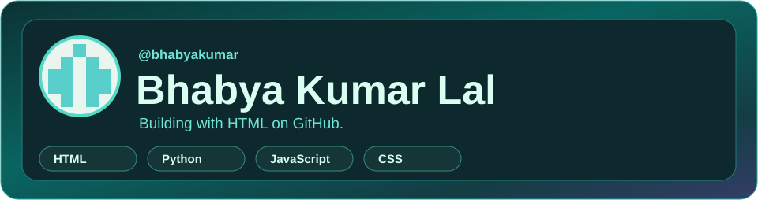
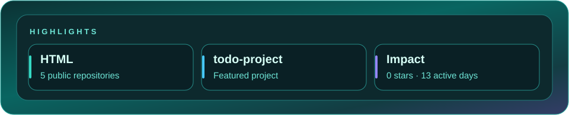
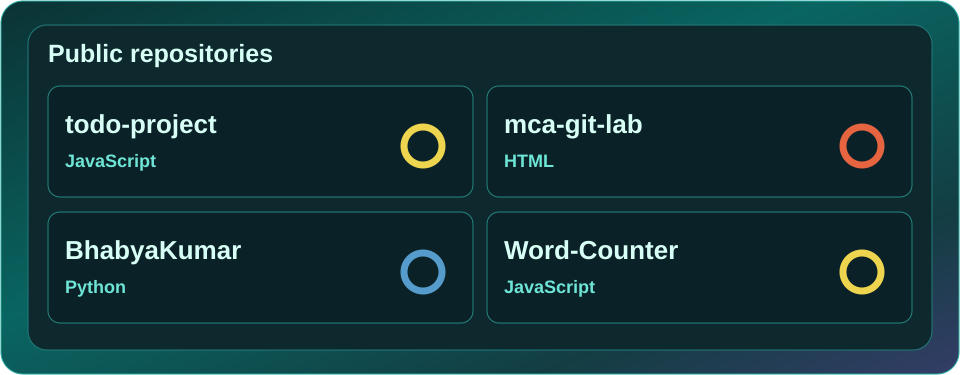
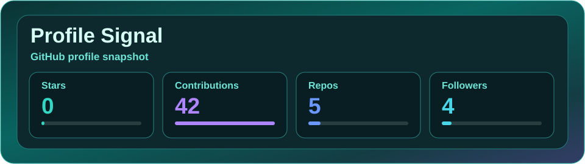
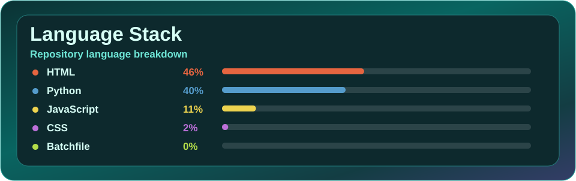

<h1 align="center">Bhabya Kumar Lal</h1>

<strong>Frontend &amp; full-stack development</strong>

Building useful things with HTML and shipping in public.

Based in Dehradun

| Followers | Repositories | Stars | Contributions |
| :---: | :---: | :---: | :---: |
| 4 | 5 | 0 | 42 |

<a href="https://github.com/BhabyaKumar">GitHub</a>

## Building in public

<table><tr><td width="62%">

I build small web tools, from a word counter to a JavaScript to-do project.

<strong>Focus</strong> · HTML · Python · JavaScript

Explore the source and follow each project as it grows.

</td><td width="38%"></td></tr></table>

## What I’m shipping

## Featured work

<table><tr><td width="58%"></td><td>
<h3><a href="https://github.com/BhabyaKumar/todo-project">todo-project</a></h3>

A JavaScript project for keeping track of to-dos.

JavaScript · ⭐ 0 stars

<a href="https://github.com/BhabyaKumar/todo-project">View project →</a>
</td></tr></table>

## Selected work

<table><tr><td width="33%" valign="top"><h3><a href="https://github.com/BhabyaKumar/todo-project">todo-project</a></h3>
A to-do project built with JavaScript.
JavaScript · ⭐ 0</td><td width="33%" valign="top"><h3><a href="https://github.com/BhabyaKumar/mca-git-lab">mca-git-lab</a></h3>
My MCA Git lab repository.
HTML · ⭐ 0</td><td width="33%" valign="top"><h3><a href="https://github.com/BhabyaKumar/BhabyaKumar">BhabyaKumar</a></h3>
The code and graphics behind this GitHub profile.
Python · ⭐ 0</td></tr></table>

## Signal

## Stack

## Activity

---

<table><tr><td width="78%"><h2>Let’s build something</h2>
Open to collaborating on web tools and useful open-source projects.
</td><td align="center"><a href="https://github.com/BhabyaKumar">GitHub ↗</a></td></tr></table>

Bhabya Kumar Lal · Dehradun

